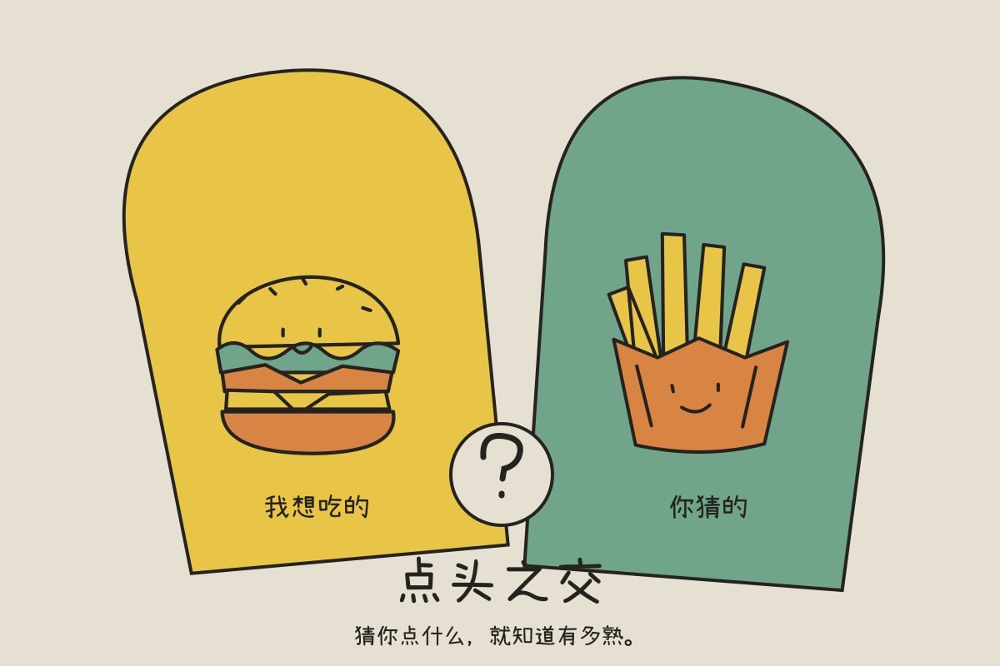
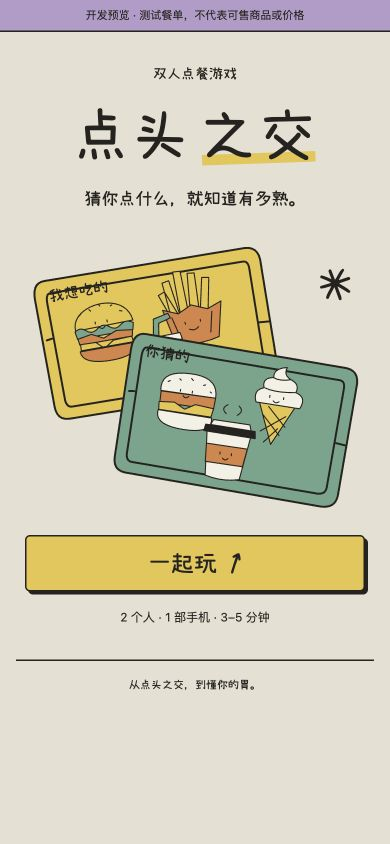
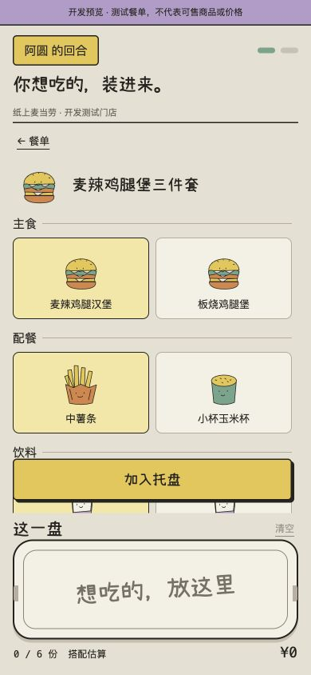
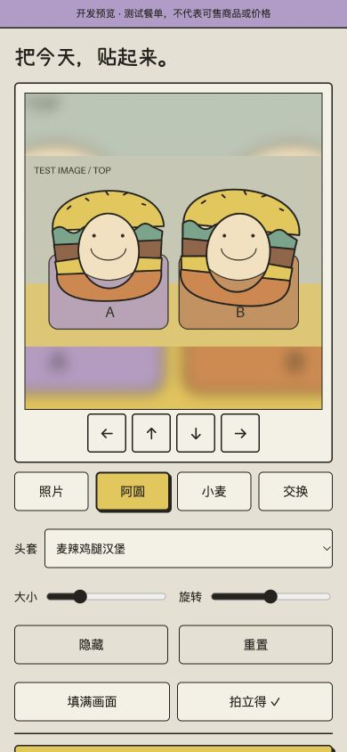
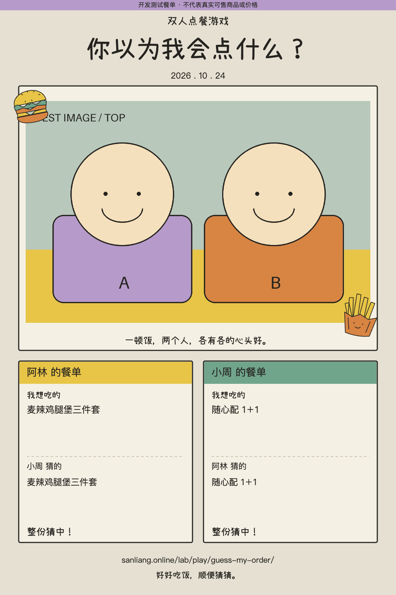
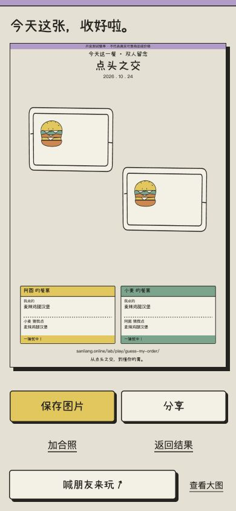

<div align="center">

# 点头之交

### 猜你点什么，就知道有多熟。

去麦当劳之前，先猜一猜对方会点什么。

**两个人 · 一部手机 · 一盘你以为 TA 会点的餐**

[开始玩 ↗](https://sanliang.online/lab/play/guess-my-order/)　·　[画面一览](#画面一览)　·　[本地运行](#本地运行)　·　[MCP 接入](MCP_INTEGRATION.md)



</div>

把自己想吃的放进托盘，再替朋友猜一盘。交换手机，封好答案，一起揭晓——汉堡猜中了，饮料呢？最后戴上餐盘里的食物头套，留一张两个人的大头贴。

无需注册游戏账号，约 3–5 分钟一局。适合准备一起去麦当劳的朋友、情侣和家人。

## 画面一览

<table>
<tr><th>01 · 一起开局</th><th>02 · 搭好这一餐</th></tr>
<tr><td align="center"></td><td align="center"></td></tr>
<tr><th>03 · 戴上食物头套</th><th>04 · 留下这次见面</th></tr>
<tr><td align="center"></td><td align="center"></td></tr>
</table>

<details>
<summary>保存、邀请与更多界面</summary>



</details>

<sub>截图使用开发测试餐单及合成照片，不代表实时供应或报价；未使用玩家真人照片。体验站与开源版保留各自署名。</sub>

## 怎么玩

| 搭一盘 | 猜一盘 | 一起揭晓 | 留张合影 |
| --- | --- | --- | --- |
| 找门店，选自己想吃的 | 猜朋友会点什么，封好答案 | 交换手机后，看看彼此猜中了什么 | 戴上食物头套，保存或喊饭搭子来玩 |

- **真实门店餐单** — 麦当劳 MCP 提供门店、单品、套餐组成与核价；供应随门店和时段变化。
- **自己的搭配** — 套餐先选饮料、配餐和规格，再整组入盘。每盘最多六份购买项，预算选填。
- **具体的默契** — 比较主餐、配餐和饮料；同样的食物通过套餐或单点取得，都算猜中。
- **食物头套合影** — 照片本机处理，支持移动、缩放、旋转、滤镜和 1080 × 1620 导出。也可不拍照，只保存餐盘卡。

游戏提供点餐参考；下单与支付在麦当劳官方渠道完成，价格以结算页为准。

## 本地运行

需要 Node.js 22.9 或更高版本。

```sh
npm ci --ignore-scripts
npm run dev
```

打开 http://127.0.0.1:18426/lab/play/guess-my-order/ 。开发模式使用明确标记的模拟餐单，不需要密钥，限本机访问。没有数据库、构建步骤或运行时大模型。

### 使用真实门店和菜单

由账号本人在 [麦当劳开放平台](https://open.mcd.cn/mcp) 开通 Token，在 [腾讯位置服务](https://lbs.qq.com/) 开通 WebService Key；复制 `.env.example` 为 `.env`，填写自己的凭证：

```sh
cp .env.example .env
# 在本机编辑 .env，填入自己的 Token 和 Key
chmod 600 .env
npm start
```

凭证仅在服务端使用，不要提交 `.env`。腾讯 Key 需配置服务出口 IP，并为关键词提示、坐标转换和逆地址解析分配额度。

检查代码：

```sh
npm test
```

## 开发与部署

原生 HTML / CSS / JavaScript + Node.js 内置 HTTP 服务；无需数据库或运行时大模型。

| 目录 / 文件 | 职责 |
| --- | --- |
| `public/` | 游戏流程、托盘插画、合影编辑与导出 |
| `server.mjs` | HTTP 服务、校验、缓存与限流 |
| `mcp.mjs` / `places.mjs` | 菜单核价与地点解析 |
| `test/` | Node 内置自动检查 |

[部署说明](deploy/README.md) · [MCP 接入](MCP_INTEGRATION.md) · [验收范围](ACCEPTANCE.md) · [技术交接](HANDOFF.MD) · [素材来源](ASSETS.md)

## 隐私与兼容

照片和脸部位置在本机处理，不上传、不持久保存。昵称与答案保存在当前浏览器会话；刷新后照片需重选。定位仅在点击并授权后进行，坐标由腾讯位置服务解析。

食物头套检测在选择照片后才加载同源 MediaPipe 与模型，10 秒超时后转为手动放置。保存与分享取决于浏览器能力；Android 微信等设备的实际验收范围见[验收记录](ACCEPTANCE.md)。

自部署需使用自己的服务端密钥。服务不开放任意 MCP 代理；菜单与报价缓存五分钟，上游最多两个并发。封存是同机游戏交接机制，并非浏览器存储加密。

## 许可与参赛

原创代码与插画采用 [MIT](LICENSE)，小赖字体采用 [SIL OFL 1.1](public/assets/Xiaolai-OFL.txt)。本作非麦当劳官方产品。

[参赛声明](CONTEST_DECLARATION.md)按官方原文保留；项目使用麦当劳 MCP，不申报 WorkBuddy 专项奖励。项目展示名为「点头之交」，仓库地址保留 `mcd-guess-my-order`，以延续报名及已有链接。

---

<div align="center">从点头之交，到懂你的胃。</div>
